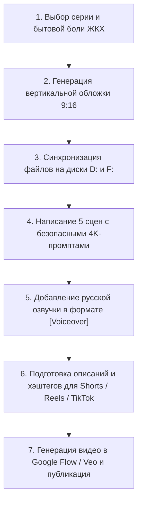

# 📖 ПОЛНАЯ БИБЛИЯ ПРОЕКТА: «СЕМЕЙКА АДАМОВЫХ В КАЗАХСТАНСКОМ ЖКХ»
### Единый мастер-документ: контекст продукта Fixly, маркетинговая вселенная, персонажи, сценарии (1–30 серии), безопасные 4K-промпты и архив ассетов

---

## 📌 ОГЛАВЛЕНИЕ
1. [Манифест и цели документа](#1-манифест-и-цели-документа)
2. [Контекст и экосистема продукта Fixly (SaaS для ОСИ в Казахстане)](#2-контекст-и-экосистема-продукта-fixly)
3. [Маркетинговая философия и стратегия вирусного веб-сериала](#3-маркетинговая-философия-и-стратегия-сериала)
4. [Библия персонажей (Character Roster & Prompts)](#4-библия-персонажей-character-roster)
5. [Правила безопасности генерации (Safety & Zero-Filter Guide)](#5-правила-безопасности-генерации)
6. [Хроника и синопсисы Сезона 1 (Серии 1–13)](#6-хроника-и-синопсисы-сезона-1-серии-113)
7. [Серия 14: «Включили отопление?!» (Сценарий, промпты, тексты)](#7-серия-14-включили-отопление)
8. [Серия 15: «Невеста Фестера: Любовь с первого разряда»](#8-серия-15-невеста-фестера)
9. [Большая 15-серийная сага: Любовь Фестера и Дебби (Серии 16–30)](#9-большая-сага-фестер-и-дебби-серии-1630)
10. [Полный сценарий и промпты: Серия 16 («Свидание в бойлерной»)](#10-серия-16-свидание-в-бойлерной)
11. [Полный сценарий и промпты: Серия 17 («Чай у Бабушки»)](#11-серия-17-чай-у-бабушки)
12. [Полный сценарий и промпты: Серия 18 («Битва за чердак»)](#12-серия-18-битва-за-чердак)
13. [Синопсисы и концепции будущих серий 19–30](#13-синопсисы-будущих-серий-1930)
14. [Реестр медиа-активов, обложек и каталогов файлов](#14-реестр-медиа-активов-и-обложек)
15. [Производственный регламент создания новых серий (SOP)](#15-производственный-регламент-создания-серий)

---

## 1. МАНИФЕСТ И ЦЕЛИ ДОКУМЕНТА

Настоящий документ является **Единым Источником Истины (Single Source of Truth)** для:
* Основателя стартапа **Fixly** (Рахим, Казахстан);
* Команды сценаристов, промпт-инженеров и видеомейкеров;
* Нейросетевых агентов и ассистентов для генерации контента без потери контекста.

В документе объединены:
1. **Продуктовая основа:** Архитектура, боли жильцов и председателей ОСИ, законодательство РК (Закон об ОСИ, Приказ МИИР № 163).
2. **Креативная надстройка:** Культовый комедийный сериал с Семейкой Адамовых, перенесённой в реалии казахстанской хрущёвки/многоэтажки.
3. **Готовые скрипты и медиа:** Все сценарии, пошаговые промпты для видеонейросетей (Google Flow / Veo / Imagen 3), готовые русские озвучки, описания для соцсетей и адреса обложек.

---

## 2. КОНТЕКСТ И ЭКОСИСТЕМА ПРОДУКТА FIXLY

### 🏢 Что такое Fixly
**Fixly** — это современное PWA-приложение (Progressive Web App) и мобильный сервис для прозрачного управления объединениями собственников имущества (ОСИ) и простыми товариществами (ПТ) в Казахстане (старт: Кокшетау, масштабирование: Астана, Алматы, Шымкент, Караганда и все регионы РК).

* **Модель монетизации:** B2B2C SaaS. Подписку оплачивает ОСИ (председатель из общедомового бюджета управления), а жильцы получают бесплатный мобильный личный кабинет с нулевым порогом входа.
* **Главный аргумент продажи председателю:** Избавление от многочасовой ручной рутины в Excel и страха проверок Жилищной инспекции благодаря **автоматической генерации ежемесячных финансовых отчётов по форме Приказа МИИР РК № 163**.

### ⚖️ Жёсткие правовые и технические ограничения
1. **Локализация данных (Data Residency):** В соответствии с законами РК о персональных данных, данные жителей и финансовые выписки хранятся **исключительно на серверах внутри Республики Казахстан**. Никаких внешних облачных баз (Supabase/Vercel/AWS за рубежом исключены). Self-hosted сервер на казахстанском VPS.
2. **Технологический стек:**
   * **Web:** Next.js (App Router, TypeScript), Prisma ORM, PostgreSQL (в Docker), PgBouncer, Nginx/Caddy, PWA-сервис-воркеры.
   * **Mobile:** Flutter (`fixly` в монорепозитории `/app`).
   * **Безопасность:** Мультитенантность с изоляцией данных через `forTenant()`, двухфакторная аутентификация (2FA), разграничение ролей (Жилец, Председатель, Бухгалтер, Мастер, Супер-админ).

### 🛠 Ключевые модули продукта, отражённые в сюжете
1. **Отчётность по Приказу № 163:** Разделение текущего счёта и сберегательного фонда капремонта, скрытие ПДн, автоматическая выгрузка из банковских реестров.
2. **«Модуль Мастер» (Маркетплейс проверенных мастеров):** Вызов верифицированных электриков, сантехников, кровельщиков с фиксированными тарифами и фотофиксацией до/после.
3. **Онлайн-голосования и опросы:** Легитимное принятие решений собственниками с кворумом прямо с мобильного (без замерзания во дворе).
4. **Умный дом и двор (СКУД):** Видеодомофоны, умные шлагбаумы, доступ на чердаки и в бойлерные по защищённым цифровым ключам.
5. **Финансовая прозрачность:** Официальные пуш-оповещения, выписки расходов, защита от распила и двойных квитанций старых КСК.

---

## 3. МАРКЕТИНГОВАЯ ФИЛОСОФИЯ И СТРАТЕГИЯ СЕРИАЛА

### 🎯 Концепция сериала
Семья Адамовых въезжает в обычный многоквартирный дом в Казахстане и возглавляет ОСИ. То, что для обычных жильцов является бытовым адом (ледяные батареи, короткие замыкания, залитые подвалы, ядовитые споры в домовом чате, голуби на чердаке), для Адамовых — высшая форма уюта и романтики. При этом за счёт прагматичного ума Уэнсдей и цифрового порядка они наводят в доме идеальную чистоту.

### 🚫 Философия «Zero Direct Ads» (Никакой прямой рекламы)
* **Запрет:** В видео **категорически запрещено** произносить шаблонные рекламные лозунги: *«Скачивайте приложение Fixly в AppStore!»*, *«Fixly — лучший сервис для ЖКХ!»*.
* **Правило:** Продукт внедряется **исключительно нативно (ambient placement)**, как в популярных веб-сериалах («Альтушкины» и др.):
  * Экран смартфона в руках Уэнсдей с логотипом Fixly;
  * Тихо пиликнувшее push-уведомление *«Заявка сантехнику принята»*;
  * Настенный монитор диспетчеризации в подвале;
  * Сканирование QR-кода на информационной доске в подъезде.

### 🎥 Визуальный стиль и стандарты генерации
* **Формат:** 9:16 (вертикальное видео под YouTube Shorts, Instagram Reels, TikTok).
* **Стиль картинки:** Clean modern digital cinematography, sharp 4k, cinematic rim lighting, photorealistic textures.
* **Запрет на ретро-эффекты:** **Никакого плёночного шума (no 35mm film grain, no light leaks, no dust)!** Картинка должна быть ультра-чёткой, сочной и современной.
* **Канал дистрибуции:** Официальный YouTube-канал проекта: `https://www.youtube.com/@fixly_kz/shorts`.

---

## 4. БИБЛИЯ ПЕРСОНАЖЕЙ (CHARACTER ROSTER)

| Персонаж | Промпт-тег / Описание внешности | Роль в сериале и характер | Комедийная фишка |
|---|---|---|---|
| **Гомес Адамов** | `@Gomez` — стильный мужчина в тонких полосатых костюмах-тройках, тонкие усики, сигара, блестящие лакированные туфли. | Председатель ОСИ. Романтик, фанат хаоса. Восхищается любыми авариями и скандалами соседей. | Целует руку Мортиши при каждом звуке прорвавшейся трубы; готов платить двойные квитанции ради «удвоения страданий». |
| **Мортиша Адамова** | `@Morticia` — высокая, бледная, длинные прямые смоляные волосы, облегающее чёрное платье с разрезом, элегантные манеры. | Первая леди дома. Ведёт эстетику подъезда: срезает бутоны роз, оставляя колючие стебли. | Считает яркие белые цвета «верхом жестокости и бездушия»; умиляется разрухе. |
| **Уэнсдей Адамова** | `@Wednesday` — девочка/подросток с двумя черными косичками, строгий школьный воротничок, каменное невозмутимое лицо. | Технический директор и контрразведка дома. Не расстаётся со смартфоном/планшетом. | Решает вековые проблемы ЖКХ за 3 клика в Fixly, взламывает махинации аферистов с холодным сарказмом. |
| **Пагсли Адамов** | `@Pugsley` — пухлый мальчик в полосатой футболке и шортах, вечно с огромным разводным ключом или взрывпакетом. | Главный разрушитель и краш-тестер общедомового имущества. | Скручивает краны, устраивает гейзеры из батарей, тестирует прочность лифта. |
| **Дядя Фестер** | `@Fester` — круглый лысый бледный мужчина в глухом темном пальто, с горящей лампочкой во рту. | Главный электрик дома, пироман, наивный романтик. Влюбляется в Дебби. | Питается электричеством 380V, искрит от чувств, считает попытки покушения лучшим массажем и заботой. |
| **Бабушка Эудора** | `@Grandmama` — седая растрёпанная ведьма в шали и фартуке, с половником и котлом наперевес. | Ревизор традиций, специалист по зельям и опрессовке отопления. | Варит супы из машинного масла и белладонны; её чаёк превращает фикусы в хищных монстров. |
| **Рука «Вещь»** | `@Thing` — живая самостоятельная рука в кружевных манжетах или белых перчатках сомелье. | Идеальный завхоз, курьер, официант и хакер. | Разносит уведомления, открывает замки, ставит штампы «ОТКАЗАНО» на лбы аферистов. |
| **Дон Голубь** | `@Pigeon` — упитанный серый голубь в черных очках-каплях и мини-шляпе федоре. | Теневой авторитет чердака, распильщик смет 90-х годов. | Сидит на балке, щёлкает семки, сбрасывает рубероид на наглых аудиторов, «держит район». |
| **Дебби Желлински** | `@Debbie` — ослепительная платиновая блондинка 90-х в белоснежных костюмах, с жемчугом и притворной улыбкой. | Профессиональная аферистка («Чёрная вдова»), лже-аудитор счетов дома. | Пытается женить на себе Фестера, чтобы украсть фонд капремонта; в шоке от того, что Фестера невозможно убить. |

---

## 5. ПРАВИЛА БЕЗОПАСНОСТИ ГЕНЕРАЦИИ (SAFETY & ZERO-FILTER GUIDE)

Чтобы промпты гарантированно проходили строгие автоматические фильтры безопасности нейросетей (Google Flow, VideoFX, Veo, Midjourney, Imagen 3), строго соблюдаются следующие правила:

1. **Child Safety (Защита детей):**
   * **Никогда** не помещать детей (`@Pugsley`, `@Wednesday`) рядом с открытым кипятком, паром под высоким давлением, оголёнными силовыми проводами или опасным инструментом.
   * Если в сцене нужен гаечный ключ или пар — исполнителем выступает взрослый (`@Fester` или `@Gomez`), либо ситуация подаётся через безопасную мультяшную гиперболу.
2. **Исключение триггеров Self-Harm / Ingestion:**
   * Запрещено писать: *«eats smoking fuse»* (ест дымящийся предохранитель) или *«drinks deadly poison»* (пьёт смертельный яд).
   * **Безопасная замена:** Галантный тост с шампанским, поднятие серебряного колпака-блюда, сливание чая в горшок с растением (где мутирует цветок, а не человек).
3. **Исключение триггеров Gore / Body Horror:**
   * Запрещено писать: *«severed crawling hand»* (оторванная ползущая рука) или *«hand crawls through door crack»*.
   * **Безопасная замена:** *«A friendly detached magical hand wearing a crisp white waiter cuff gracefully serves champagne»*.
4. **Фильтр сцен катастроф и терроризма:**
   * Запрещено использовать слова: *«bomb»*, *«explosion»*, *«Chernobyl»*, *«terrorist»*, *«horror»*.
   * **Безопасная замена:** *«comedic sudden release of harmless white steam from a safety valve»*, *«theatrical comedic surprise»*, *«romantic dark gothic comedy atmosphere»*.

---

## 6. ХРОНИКА И СИНОПСИСЫ СЕЗОНА 1 (СЕРИИ 1–13)
*(Все серии успешно созданы и опубликованы на канале `@fixly_kz/shorts`)*

* **Серия 1: «Потоп в 42-й квартире»** — С потолка у Адамовых капает ржавая жижа. Гомес и Мортиша ловят капли в бокалы под вальс. Первый звонок председателю старого КСК, который отключает телефон.
* **Серия 2: «Выборы при свечах»** — Подъезд погружён во тьму. Жильцы ругаются у почтовых ящиков. Гомес выходит с факелом и предлагает свою кандидатуру на пост председателя ОСИ: «Я обещаю вам истинные страдания!». Жильцы единогласно «за».
* **Серия 3: «Шок от счёта за тепло»** — Приходят первые квитанции за обогрев воздуха. Мортиша любуется астрономической суммой, но Уэнсдей начинает оцифровку общедомового прибора учёта тепла.
* **Серия 4: «Спуск в подвал»** — Гомес и Вещь спускаются в сырой катакомбный подвал пятиэтажки в поисках запорной арматуры.
* **Серия 5: «Встреча с Голубем-олигархом»** — На чердаке обнаружен серый голубь в солнцезащитных очках, обустроивший логово из старых бумажных квитанций и контролирующий капремонт.
* **Серия 6: «Обход двора: Битва за баки»** — Разруха на мусорной площадке, строительный мусор от соседей. Гомес в восторге от пейзажа постапокалипсиса, Пагсли тестирует гравитацию на качелях.
* **Серия 7: «Ночной дебош Пагсли и отмена бумажек»** — Пагсли сжигает бумажные квитанции в подъезде. Уэнсдей переводит весь дом на электронные квитанции в смартфонах за 1 минуту.
* **Серия 8: «Явление Дяди Фестера»** — В доме загадочно мигает свет. В распределительном щитке обнаружен Дядя Фестер, заряжающийся напрямую от фазы 380V с горящей лампочкой во рту.
* **Серия 9: «Тайна общедомового расхода (ОДН на 300 000 ₸)»** — Жильцы в шоке от гигантских счетов за электричество. Фестер и Уэнсдей находят соседа, запитавшего тёплый пол от подъездного кабеля.
* **Серия 10: «Мы пришли на чай!»** — Адамовы в полном составе стучат в дверь должника с тортом из колючей проволоки. Дипломатия вежливости.
* **Серия 11: «Я всё оплачу!»** — Сосед-неплательщик в панике выбрасывает белый флаг и моментально погашает долг через смартфон.
* **Серия 12: «Бабуля приехала!»** — В подъезд заходит Бабушка Эудора с чемоданом, из которого торчат кости и метла. Подготовка к отопительному сезону по ведьминым канонам.
* **Серия 13: «Банный день Бабули (Опрессовка)»** — Испытание труб давлением. Все соседи сидят с красными тазиками, а Бабушка кайфует в кипящем ведьмином СПА.

---

## 7. СЕРИЯ 14: «ВКЛЮЧИЛИ ОТОПЛЕНИЕ?!» (БИТВА ЗА СТОЯКИ)

* **Сезонный контекст:** Октябрь в Казахстане. Старт отопительного сезона. Завоздушенные стояки, гидроудары, холод на нижних этажах и жара на верхних.
* **Обложка (9:16):** `cover_ep14_heating_season_*.jpg` (Текст: `14 СЕРИЯ / ВКЛЮЧИЛИ ОТОПЛЕНИЕ?!`).
* **Локации файлов:** `D:\загрузки\Обложки_Адамовы\` и `F:\Обложки_Адамовы\`.

### 📜 Сценарий и 4K-промпты

**Сцена 1 (0:00–0:06) — Осенняя симфония труб**
```text
Vertical 9:16 video. Clean modern digital cinematography, sharp 4k, no film grain. Inside a moody vintage apartment living room, @Gomez in a pinstripe tuxedo stands near an old cast-iron radiator that is violently shaking, hissing, and whistling loud steam. Gomez smiles with charmed theatrical joy, listening intently. [Voiceover: "Послушай эту мелодию, дорогая... Городские теплосети дали отопление! Стояки поют, как раненый дракон!"]
```

**Сцена 2 (0:06–0:12) — Бунт Бабули**
```text
Vertical 9:16 video. Clean modern digital cinematography, vibrant colors, no vintage effects. @Grandmama with wild grey hair rushes into the room waving a wooden ladle, glaring angrily at the hissing radiator. A tiny funny spider drops down from the ceiling on a web. Grandmama complains dramatically. [Voiceover: "Бабуля: Этот ультразвук распугал всех моих домашних пауков! Перекрой вентиль, Гомес, иначе я сварю сантехника живьем!"]
```

**Сцена 3 (0:12–0:18) — Пагсли и разводной ключ**
```text
Vertical 9:16 video. High resolution, 4k. Comedic slapstick scene. @Pugsley holding a comically oversized rusty wrench approaches the vibrating radiator with a mischievous grin. Gomez proudly pats him on the back. A sudden blast of harmless warm white water and mist sprays straight up toward the ceiling like a mini geyser. [Voiceover: "Гомес: Мой мальчик! Учись стравливать воздух вручную! Главное — сорвать резьбу до основания!"]
```

**Сцена 4 (0:18–0:24) — Профессионал в деле (Ambient Placement)**
```text
Vertical 9:16 video. Clean modern 4k cinematography. A calm professional heating technician in a sleek blue work jumpsuit with a modern digital thermal imager inspects the pipe. Beside him, Wednesday calmly looks at her smartphone screen showing a clean telemetry dashboard. The technician twists a valve, and the hissing instantly stops. [Voiceover: "Уэнсдэй: Пока мужчины развлекаются потопом, сертифицированный мастер из Fixly балансирует стояк за четыре минуты. Без криков в домовом чате."]
```

**Сцена 5 (0:24–0:30) — Идеальный замогильный баланс**
```text
Vertical 9:16 video. Cinematic wide vertical shot. Morticia lounges in a black velvet armchair snipping black rosebuds, while Gomez kisses her hand. The radiator is now whisper quiet and gently warming the gloomy room. Wednesday sips black tea. [Voiceover: "Мортиша: Какая восхитительная тишина... Теперь можно спокойно наслаждаться осенними заморозками."]
```

### 📱 Тексты публикаций 14 серии
* **YouTube Shorts:** `14 СЕРИЯ: Включили отопление?! Битва за стояки в доме Адамовых 💨💀 #семейкаадамс #shorts`
* **TikTok / Reels:** Жиза каждого дома в октябре! На 9 этаже баня +35, на 1 этаже дубак, а Пагсли сорвал кран Маевского газовым ключом! А вам уже дали тепло? Пишите в комменты свой город и температуру! 👇

---

## 8. СЕРИЯ 15: «НЕВЕСТА ФЕСТЕРА: ЛЮБОВЬ С ПЕРВОГО РАЗРЯДА»

* **Контекст:** Ввод персонажа **Дебби Желлински (`@Debbie`)** — блондинки-аудитора в белоснежном брючном костюме 90-х.
* **Обложка (9:16):** `cover_ep15_fester_bride_*.jpg` (Текст: `15 СЕРИЯ / НЕВЕСТА ФЕСТЕРА!`).
* **Эталон персонажа:** `debbie_portrait_*.jpg`.

### 📜 Сценарий и 4K-промпты

**Сцена 1 (0:00–0:06) — Ослепительное появление Дебби**
```text
Vertical 9:16 video. Clean modern digital cinematography, sharp 4k, no film grain. An old Soviet apartment building entrance. An attractive glamorous blonde woman Debbie in an immaculate pastel white suit and pearl necklace walks in on high heels holding a black document audit folder. Sharp comedic contrast between her bright angelic look and the dark gloomy stairwell. [Voiceover: "Цок-цок-цок... Какой колоритный дом. И где же тут сидит их наивный домовой комитет?"]
```

**Сцена 2 (0:06–0:12) — Любовный удар током**
```text
Vertical 9:16 video. Clean digital cinematography, 4k. Near an open hallway electrical panel, pale bald Uncle Fester turns around holding a wire. He freezes, staring at Debbie with wide lovestruck eyes. Suddenly, the incandescent lightbulb in his hand bursts into brilliant blinding warm light from his excitement. Comedic blushing expression. [Voiceover: "Дзынь! Мама дорогая... Меня только что ударило любовью на триста восемьдесят вольт!"]
```

**Сцена 3 (0:12–0:18) — Романтический подгон**
```text
Vertical 9:16 video. Clean modern cinematography. Uncle Fester bashfully presents Debbie with a tangled bouquet of shiny copper wires and a vintage fuse. Debbie smiles with an overly sweet fake smile, tilting her head coquettishly. [Voiceover: "Это вам, прекрасная незнакомка! Чистая медь! Без примесей! — О, как мило... А вы, случайно, не имеете доступа к счетам дома?"]
```

**Сцена 4 (0:18–0:24) — Семейный совет в шоке**
```text
Vertical 9:16 video. Clean modern digital cinematography, sharp 4k, no film grain. Candlelit gothic living room with dark velvet curtains. An elegant man with a thin mustache in a dark pinstripe suit and a tall pale woman with sleek black hair in a long black dress stand side-by-side, looking with funny theatrical admiration at a blonde woman in a bright white suit sitting on a vintage armchair. High contrast lighting, humorous deadpan expressions, cinematic quality. [Voiceover: "Она в белом, Гомес... Без единого темного пятна! Какая бессердечная, безжалостная жестокость! Фестер, ты нашел настоящее сокровище!"]
```

**Сцена 5 (0:24–0:30) — Коварный план (Клиффхэнгер)**
```text
Vertical 9:16 video. Clean 4k shot. Debbie gently hugs Uncle Fester, while behind his back she slyly opens her contract folder, eyes gleaming with greed. In the background, Wednesday stands completely motionless holding her smartphone, silently watching Debbie like a hawk. [Voiceover: "Скоро этот лысый романтик перепишет на меня весь фонд капремонта... Любовь окрыляет!"]
```

---

## 9. БОЛЬШАЯ САГА: ФЕСТЕР И ДЕББИ (СЕРИИ 16–30)

По требованию создателя проекта, свадьба не наступает мгновенно, а является **кульминацией масштабной 15-серийной сюжетной арки** борьбы аферистки Дебби с неприступной крепостью цифрового ОСИ и неуязвимостью влюбленного Фестера.

### 🎭 Структура 4 Актов:
* **АКТ I: Притирка и семейная проверка (Серии 16–19)** — Свидание в подвале, проверка чаем Бабушки с мышьяком, битва Дебби с Голубем за чердак, ночной рейд за печатью.
* **АКТ II: «Несчастные случаи» по большой любви (Серии 20–23)** — Покушения Дебби на Фестера (380 Вольт в ванной, сорванный трос люльки, взрыв мангала, падающий лифт), которые Фестер воспринимает как высшее блаженство и заботу.
* **АКТ III: Контрразведка и общедомовой бунт (Серии 24–27)** — Цифровое досье от Уэнсдей, провал троллинга в домовом чате, фиаско на общем собрании, подарок от Пагсли.
* **АКТ IV: Финал — Помолвка и Свадьба года в ОСИ (Серии 28–30)** — Готический казахский кудалык, мальчишник в подвале и Свадьба во дворе с разоблачением кражи капремонта через отчёт Приказа № 163.

---

## 10. СЕРИЯ 16: «СВИДАНИЕ В БОЙЛЕРНОЙ!»

* **Обложка (9:16):** `cover_ep16_boiler_date.jpg` (Текст: `16 СЕРИЯ / СВИДАНИЕ В БОЙЛЕРНОЙ!`).
* **Локации:** `D:\загрузки\Обложки_Адамовы\` и `F:\Обложки_Адамовы\`.

### 📜 Сценарий и 4K-промпты

**Сцена 1 (0:00–0:10) — Вход в обитель страсти**
```text
Vertical 9:16 video. Clean modern digital cinematography, sharp 4k, no film grain. A dimly lit industrial apartment basement boiler room with heavy steel heating pipes, brass valves, and glowing steam. On the left, glamorous platinum blonde Debbie in an immaculate white evening dress and pearls walks cautiously on high heels. On the right, pale bald Uncle Fester in a dark coat and funny chef apron welcomes her warmly, offering a cluster of shiny copper wires with a glowing incandescent lightbulb. [Voiceover: "Фестер, милый... Ты обещал самый горячий ресторан города! — Именно так, моя ласточка! Центральный теплопункт дома! Здесь шесть атмосфер и чистая страсть!"]
```

**Сцена 2 (0:10–0:20) — Столик на двоих и шустрый официант**
```text
Vertical 9:16 video. Clean digital cinematography, 4k. Romantic dinner table set atop a massive insulated industrial heating pipe inside a dark basement. Candlelight flickers from candles placed inside rusty iron pipe fittings. Uncle Fester gallantly pulls out a chair for Debbie in her white silk dress. A detached magical hand wearing a crisp white waiter cuff deftly pours bubbly champagne into crystal glasses. [Voiceover: "Какая... оригинальная подача. А кто этот шустрый официант? — Это Вещь! Он у нас и за сомелье, и за аварийную службу!"]
```

**Сцена 3 (0:20–0:32) — Фирменное блюдо и разговор о миллионах**
```text
Vertical 9:16 video. Close-up table shot. Clean modern digital cinematography, 4k. Across a candlelit table, pale bald Uncle Fester raises a crystal glass of champagne with a charming, lovestruck smile. Opposite him, glamorous blonde Debbie smiles sweetly while leaning forward, holding a stylish notebook and a golden pen, asking curious questions. Warm glowing candlelight, crisp details of white silk and dark coat, no film grain. [Voiceover: "Угощайся, Дебби! Лучшее угощение для лучшей гостьи! — Восхитительно, Фестер... А скажи, правда ли, что на счете капремонта вашего дома тридцать миллионов? И доступ к счету только у твоей семьи?"]
```

**Сцена 4 (0:32–0:42) — Испытание паром**
```text
Vertical 9:16 video. A sudden dramatic burst of white steam releases from a safety valve behind the romantic table in the basement. Debbie shrieks in shock, holding her hair while leaning back in fear. Uncle Fester stands up ecstatically, inhaling the warm mist with arms spread wide in pure joy. On the background wall, a modern digital telemetry monitor displays glowing green status. Dynamic cinematic lighting, volumetric steam rays, crisp 4k, no film grain. [Voiceover: "Боже, мы взлетим на воздух?! Где пожарные?! — Обожаю этот аромат! Автоматика сбросила лишнее давление! Никакой опасности, чистый релакс!"]
```

**Сцена 5 (0:42–0:52) — Капкан захлопнулся (Клиффхэнгер)**
```text
Vertical 9:16 video. Basement exit staircase, dramatic moody shadows. Uncle Fester softly kisses Debbie's manicured hand, a warm incandescent bulb gently glowing in his mouth from pure love. Debbie, slightly disheveled with soot but maintaining a razor-sharp wicked smile, looks over his shoulder directly into the camera with predatory ambitious eyes. Cinematic 4k, vibrant yellow glow against darkness, no film grain. [Voiceover: "Мы увидимся снова, Дебби? — Обязательно, Фестер... Познакомь меня со своей семьей. Я хочу изучить ваш дом изнутри!"]
```

---

## 11. СЕРИЯ 17: «ЧАЙ У БАБУШКИ!»

* **Обложка (9:16):** `cover_ep17_grandmama_tea.jpg` (Текст: `17 СЕРИЯ / ЧАЙ У БАБУШКИ!`).
* **Локации:** `D:\загрузки\Обложки_Адамовы\` и `F:\Обложки_Адамовы\`.

### 📜 Сценарий и 4K-промпты

**Сцена 1 (0:00–0:10) — Знакомство на кухне**
```text
Vertical 9:16 video. Clean modern digital cinematography, sharp 4k, no film grain. Inside a moody gothic apartment kitchen with hanging dried herbs, garlic, and antique jars. Grandmama with wild frizzy grey hair and a rustic knitted shawl stands at the table, glaring with deep comedic suspicion at glamorous blonde Debbie Jellinsky who stands politely in an immaculate bright white suit and pearls. Dramatic contrast between ancient witchcraft kitchen and chic white fashion. [Voiceover: "Бабушка (с прищуром): Так вот ты какая, невеста Фестера... Слишком белая. Слишком чистая. Ни одного пятнышка плесени!"]
```

**Сцена 2 (0:10–0:20) — Подача «фирменного» чая**
```text
Vertical 9:16 video. Clean 4k digital. Grandmama with a mischievous cackling grin lifts an antique tarnished teapot and pours a smoking, glowing violet liquid into a cracked porcelain teacup. Across the rustic wooden table, Debbie forces an overly sweet, frozen polite smile while her eyes widen in silent panic at the bubbling tea. Atmospheric candlelit shadows, volumetric purple steam. [Voiceover: "Бабушка: Выпей моего фирменного чайку, деточка! Аконит, белладонна и капелька машинного масла для аромата! Дебби (сдавленно): Ой... как гостеприимно..."]
```

**Сцена 3 (0:20–0:30) — Фокус с фикусом**
```text
Vertical 9:16 video. Mid-shot. Grandmama turns her back toward a large black simmering pot on the stove, stirring it with a big wooden spoon. Seizing the exact moment, Debbie swiftly and slyly dumps the smoking purple tea from her cup into a potted houseplant standing by the kitchen door, quickly returning the empty cup to her lips with a fake smile. Sharp comedic timing, warm candle glow. [Voiceover: "Дебби (шепотом): Ага, сейчас, разбежалась травиться... Лучше подкормим цветочек!"]
```

**Сцена 4 (0:30–0:40) — Мутация цветка**
```text
Vertical 9:16 video. Close-up on the potted houseplant. As the purple liquid soaks into the soil, the green plant instantly shivers and violently mutates! Glowing neon spikes pop out along the stems, and a funny carnivorous toothy flower opens wide, snapping its jaws in the air. Debbie jumps back in sheer bewilderment, clutching her pearls. Comedic fantasy effects, sharp 4k focus, vibrant green and violet lighting. [Voiceover: "Звук: Ш-ш-ш-хрясь! (Цветок щелкает зубами). Дебби (в ужасе шепотом): Мама дорогая... В этом доме даже растения хотят меня сожрать!"]
```

**Сцена 5 (0:40–0:50) — Фестер в экстазе (Клиффхэнгер)**
```text
Vertical 9:16 video. Uncle Fester enters the kitchen beaming with radiant joy, a glowing lightbulb in his hand. He sees Debbie holding the empty cup with the mutating flower behind her. Grandmama stands completely flabbergasted with dropped jaw. Fester clutches his chest in utter adoration. [Voiceover: "Фестер (в экстазе): Ты выпила весь бабулин отвар залпом?! Мама, она святая женщина! У нее желудок из титана! Дебби (натужно улыбаясь): Да, милый... любовь творит чудеса..."]
```

---

## 12. СЕРИЯ 18: «БИТВА ЗА ЧЕРДАК!»

* **Обложка (9:16):** `cover_ep18_pigeon_attic.jpg` (Текст: `18 СЕРИЯ / БИТВА ЗА ЧЕРДАК!`).
* **Локации:** `D:\загрузки\Обложки_Адамовы\` и `F:\Обложки_Адамовы\`.

### 📜 Сценарий и 4K-промпты

**Сцена 1 (0:00–0:10) — Дебби на чердаке на каблуках**
```text
Vertical 9:16 video. Clean modern digital cinematography, sharp 4k, no film grain. A dusty sunlit apartment building attic with wooden rafters, floating dust particles, and cobwebs. Glamorous blonde Debbie in a white designer overcoat and red high heels carefully balances across wooden floor planks, holding a glowing digital tablet displaying 'СМЕТА КРОВЛИ 10 000 000 ₸'. She wrinkles her nose in disgust at the dust. [Voiceover: "Цок... цок... цок... Дебби (про себя): Десять миллионов на ремонт крыши... Напишу, что балки сгнили, и весь фонд капремонта мой!"]
```

**Сцена 2 (0:10–0:20) — Встреча с Доном Голубем**
```text
Vertical 9:16 video. Low-angle hero shot. Clean 4k digital. Perched proudly on a heavy oak roof beam sits a plump grey pigeon wearing tiny black sunglasses and a miniature fedora hat like a crime boss. The pigeon calmly pecks a sunflower seed, staring down with absolute cool authority. Golden shafts of dusty attic light illuminate the feathers. [Voiceover: "Звук: Зловещая мафиозная музыка. Курлык... (Хриплый голос Голубя): Ты зашла не в тот район, блондинка. Это мой чердак!"]
```

**Сцена 3 (0:20–0:30) — Война за смету**
```text
Vertical 9:16 video. Over-the-shoulder comedic shot. Debbie points her shiny digital tablet right at the seated pigeon, waving a golden pen aggressively. The pigeon remains stone-faced and unfazed, slowly tilting his head sideways, adjusting tiny sunglasses with his wing. [Voiceover: "Дебби (раздраженно): Подвинься, пернатый! С завтрашнего дня здесь работает моя карманная фирма! Никаких крошек и голубей! Голубь: Курлык... Ты не видела наши откаты за 98-й год..."]
```

**Сцена 4 (0:30–0:40) — Диверсия с рубероидом**
```text
Vertical 9:16 video. Dynamic action comedy shot. With a swift flick of his wing, the pigeon nudges an old heavy roll of black sticky tar roofing felt off the beam! The black roll tumbles down with a loud thud, scattering black soot and tar droplets straight onto Debbie's pristine white trench coat and red designer shoes. Debbie screams in pure outrage. [Voiceover: "Звук: БАМ! Шмяк! Дебби (визжит): Мое белое итальянское пальто за тысячу долларов! Ты чудовище с крыльями!"]
```

**Сцена 5 (0:40–0:50) — Объявление войны (Клиффхэнгер)**
```text
Vertical 9:16 video. Dramatic close-up on Debbie's furious face, slightly smudged with black tar, her eyes burning with vengeance as she shakes her fist at the rafters. Up above on the roof beam, the pigeon takes flight in slow motion, cooing victoriously against a sunbeam. [Voiceover: "Дебби: Я закатаю тебя в асфальт вместе с этой крышей! (Голубь победно курлыкает в вышине). В следующей серии: Ночной рейд за печатью ОСИ!"]
```

---

## 13. СИНОПСИСЫ БУДУЩИХ СЕРИЙ 19–30

* **Серия 19: «Ночной рейд за печатью ОСИ»** — Дебби крадётся ночью в кабинет председателя взломать сейф с печатью. В сейфе сидит Рука («Вещь»), которая обыгрывает её в покер и штампует надпись «ОТКАЗАНО» прямо ей на лоб. Нативный контекст: цифровая ЭЦП вместо мокрой печати.
* **Серия 20: «Ванна с пеной и 380 Вольт»** — Дебби роняет силовой кабель в ванну к Фестеру. Свет гаснет во всем районе. Сквозь дым сияющий Фестер пускает пузыри: *«Дорогая, лучший гидромассаж!»*. Нативный контекст: энергобезопасность, вызов аварийного электрика.
* **Серия 21: «Романтика на крыше и сорванный трос»** — Дебби перерезает трос люльки на высоте 10 этажа. Фестер летит с криком восторга, пружинит на мешках со строймусором и взлетает обратно на балкон с цветами. Нативный контекст: закрытые чердаки, СКУД-замки.
* **Серия 22: «Пикник во дворе и утечка газа»** — Дебби подстраивает хлопок старого баллона. Пламя опаляет только её укладку, а закопчённый Фестер кормит её стейком в форме черепа: *«С пылу с жару, как твоя любовь!»*. Нативный контекст: пожарная безопасность дома.
* **Серия 23: «Лифт судного дня»** — Дебби отключает датчики ловителей в лифте. Кабина с грохотом летит в шахту. Дебби ждёт внизу с траурным венком, но из дверей выходит счастливый Фестер, крутя сальто: *«А жители жаловались, что лифт медленный!»*. Нативный контекст: журнал планового ТО лифтов.
* **Серия 24: «Уэнсдей начинает расследование»** — Уэнсдей за ноутбуком пробивает Дебби по реестрам юрлиц: 4 смененные фамилии и 5 обанкроченных КСК. Уэнсдей жутко улыбается: *«Достойный противник»*. Нативный контекст: проверка подрядчиков и открытые базы.
* **Серия 25: «Вброс в общедомовой чат»** — Дебби с фейкового аккаунта пускает слух: *«Председатель купил вертолет на целевые сборы!»*. Но жители требуют выписку, система выгружает открытый отчёт за секунду, и тролля банят. Нативный контекст: официальные пуши вместо хаоса WhatsApp.
* **Серия 26: «Бенефис на общем собрании»** — Дебби с трибуны во дворе агитирует отдать дом её управляющей компании. Но жители во время её речи голосуют через смартфоны онлайн — 99% голосов против. Нативный контекст: электронные протоколы с кворумом.
* **Серия 27: «Подарок от Пагсли»** — Дебби пытается надеть на Фестера перстень со скрытым ядовитым шипом. Пагсли тайком подменяет кольцо на дымовую шашку, взрывающуюся фиолетовым дымом. Нативный контекст: видеонаблюдение во дворе.
* **Серия 28: «Готический Кудалык»** — Казахское сватовство по-адамовски: черный бешбармак, Мортиша дарит Дебби фамильное колье из пауков. Дебби с нервным тиком считает минуты до свадьбы, где планирует сорвать куш. Нативный контекст: традиции и добрососедство в доме.
* **Серия 29: «Мальчишник в подвале»** — Гомес, Фестер, Голубь и Рука отмечают мальчишник. Голубь приносит переписку Дебби с кипрским офшором о выводе денег в день свадьбы. Мужчины готовят ответный сюрприз. Нативный контекст: 2FA-подтверждение транзакций ОСИ.
* **Серия 30 (ГРАНД-ФИНАЛ СЕЗОНА): «Свадьба года в ОСИ: Взорванный куш»** — Торжественная готическая свадьба во дворе. Черные розы, алтарь из старых батарей. Дебби у алтаря нажимает кнопку списания 30 000 000 ₸ с капремонта... На табло вспыхивает тревога: **«Транзакция заблокирована! Автоматический отчёт по Приказу № 163 отправлен всем жильцам!»**. Дебби в истерике срывает фату и сбегает на каблуках, а счастливый Фестер с горящей лампочкой во рту машет ей вслед: *«Какая темпераментная женщина! Сердце разбито, зато баланс дома цел!»*.

---

## 14. РЕЕСТР МЕДИА-АКТИВОВ И ОБЛОЖЕК

Все файлы автоматически синхронизируются в локальные рабочие папки:
* 📁 `D:\загрузки\Обложки_Адамовы\`
* 💾 `F:\Обложки_Адамовы\`

| Файл обложки / Референса | Описание и русский текст на обложке | Статус |
|---|---|---|
| `cover_ep14_heating_season_*.jpg` | **«14 СЕРИЯ / ВКЛЮЧИЛИ ОТОПЛЕНИЕ?!»** — фонтан пара из батареи, Гомес в восторге, Бабуля с половником, Пагсли с газовым ключом. | ✅ Готово и скопировано |
| `cover_ep15_fester_bride_*.jpg` | **«15 СЕРИЯ / НЕВЕСТА ФЕСТЕРА!»** — влюбленный Фестер с лампочкой и букетом из проводов, Дебби в белом брючном костюме. | ✅ Готово и скопировано |
| `cover_ep16_boiler_date.jpg` | **«16 СЕРИЯ / СВИДАНИЕ В БОЙЛЕРНОЙ!»** — ужин при свечах на трубе теплопункта, Фестер в фартуке шефа, Дебби в белом шелке. | ✅ Готово и скопировано |
| `cover_ep17_grandmama_tea.jpg` | **«17 СЕРИЯ / ЧАЙ У БАБУШКИ!»** — Бабушка наливает фиолетовый дымящийся чай, ошарашенная Дебби и мутирующий зубастый цветок на столе. | ✅ Готово и скопировано |
| `cover_ep18_pigeon_attic.jpg` | **«18 СЕРИЯ / БИТВА ЗА ЧЕРДАК!»** — Дон Голубь в очках и шляпе на балке, Дебби на каблуках с планшетом и рулон смоляного рубероида. | ✅ Готово и скопировано |
| `debbie_portrait_*.jpg` | **Эталон персонажа Дебби (`@Debbie`)** — блондинка 90-х в белом костюме и жемчуге с кожаной папкой аудитора. | ✅ Готово и скопировано |
| `fester_portrait_*.jpg` | **Эталон персонажа Дяди Фестера (`@Fester`)** — лысый бледный пироман в темном пальто с горящей лампочкой. | ✅ Готово и скопировано |
| `grandmama_portrait_*.jpg` | **Эталон Бабушки Эудоры (`@Grandmama`)** — седая ведьма в шали. | ✅ Готово и скопировано |
| `thing_portrait_*.jpg` | **Эталон Руки («Вещь» `@Thing`)** — элегантная рука на столе. | ✅ Готово и скопировано |
| `slavic_techwear_founder_*.jpg` | **Основатель / Инженер Fixly** — славянский фаундер в черном техвире с планшетом. | ✅ Готово и скопировано |

---

## 15. ПРОИЗВОДСТВЕННЫЙ РЕГЛАМЕНТ СОЗДАНИЯ СЕРИЙ (SOP)

Для бесперебойного выпуска серий соблюдается строгий пошаговый цикл:



### Чек-лист проверки перед генерацией видео:
1. В промпте указано: `Vertical 9:16 video. Clean modern digital cinematography, sharp 4k, no film grain`?
2. Отсутствуют ли слова-триггеры безопасности (*horror, blood, poison, eats fuse, bomb*)?
3. Вся озвучка оформлена в квадратных скобках `[Voiceover: "..."]` сплошным текстом для удобной начитки?
4. Продакт-плейсмент нативен (интерфейс, пуш, монитор, мастер в форме), без навязчивых лозунгов?

---
*Документ актуален на ноябрь 2026 г. Все права на вселенную принадлежат проекту Fixly.*
